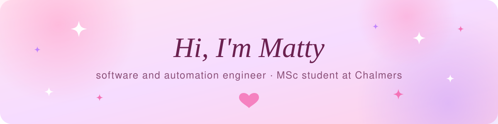
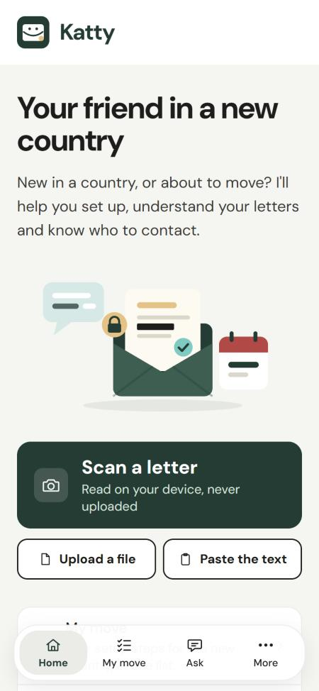
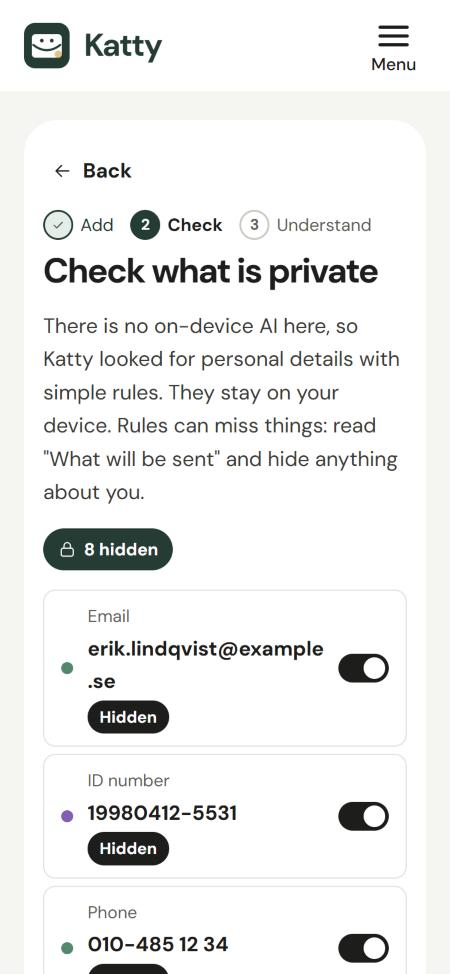
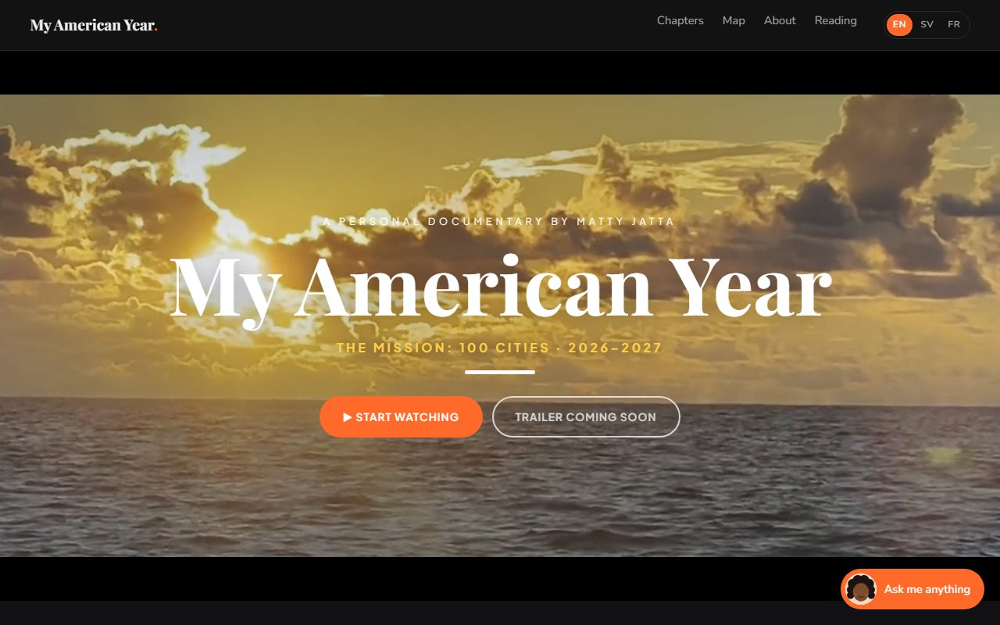

  

I'm a software and automation engineer and an MSc student in High-Performance Computer Systems at Chalmers University of Technology in Gothenburg, Sweden. Right now I'm on a one-year internship at Amerden in St. Augustine, Florida, where I build software for Automatic Guided Vehicles (AGVs) and work hands-on with the automation hardware. I like turning complex ideas into tools people can actually use.

  
  

## Right now

- Building Katty for the #BuildHybridAI 2026 hackathon
- Writing software for automated guided vehicles at Amerden in Florida
- Visiting 100 US cities for My American Year
- Back at Chalmers in Gothenburg in fall 2027

## Work

At Amerden I write software for AGV systems in C#, C++ and Python, configure vehicles with Kollmorgen NDC8 and work with PLCs. Before that I spent two summers as a data analyst at Göteborg Energi, working with Python, Power BI and Microsoft Fabric.

## Projects

### Maja
My personal AI assistant. She runs fully on my laptop with a local LLM (Llama 3.1 through Ollama), answers questions from my own documents with the source file and page, and listens and talks back with faster-whisper and Piper.

She also keeps my notes and tasks, wakes up on "Hey Maja", sends reminders and can look through the webcam with a vision model. It has unit tests and CI on GitHub Actions. The long-term goal is a small robot version of her for my desk.

[Code](https://github.com/Matjat23/maja)

### spotlight.io
A photo and video search tool my team (Isak Rodung, Joshua Shiley and I) built in one weekend at the AI4Good Hackathon 2026, where we took 3rd place. We built it for the nonprofit Dreams Come True and tested it on their photos: staff describe a moment in plain words and find it in their archive, on one laptop with no cloud.

Local models describe every photo and video frame (Qwen2.5-VL), and search combines CLIP image vectors, MiniLM text vectors and BM25 keywords with Reciprocal Rank Fusion. Whisper makes what is said in videos searchable. Staff accept or correct every AI suggestion, and faces only become anonymous groups, because the photos are of children and their families.

[Code](https://github.com/Matjat23/spotlight-ai)

### Katty
Your buddy in a new country. Katty explains an official notice, like a letter from a migration agency, a tax office or a university, after hiding your personal details on your own device. My entry for the #BuildHybridAI 2026 hackathon. I have lived in Senegal, France, Sweden and the US, and every move came with letters I did not fully understand.

In desktop Chrome, Gemini Nano runs on your device, finds names, ID numbers and addresses, and my code swaps them for labels like `[NAME_1]` (without Nano, rule-based checks do this). You see side by side what will be shared and approve it. Only then does Gemini in the cloud explain what the letter asks of you, and every point quotes the sentence it comes from, which my code checks is really in the letter. Deadlines are worked out by the code, not the AI.

On 44 made-up test letters in many languages, the rule-based check kept 207 of 208 personal details out of the shared text. It is not legal advice. Built with React, Vite and Firebase AI Logic.

  
  

[Code](https://github.com/Matjat23/kamarat) · [Live](https://kamarat-hackathon.web.app)

### Closer
An app for my partner and me while we live in Florida and Sweden, to keep the small daily rituals of a shared home going. An arc on the home screen runs from St. Augustine to Gothenburg with a heart moving along it as the days until I am home go by, and two small characters that look like us show what the other one is doing right now.

We also use it for a shared streak, a Sunday check-in with our own questions, a shared calendar and a wish list. It is a React and Vite web app on Firebase (Firestore, Google sign-in, security rules that only let the two of us in), installed on our phones. The code is private.

### My American Year
A website I built to document my year in the US, one chapter per city, with the goal of visiting 100 cities. It is a single page in plain HTML, CSS and JavaScript with an interactive map (D3), video loops, a photo viewer and English, Swedish and French. A small Python pipeline resizes my photos, strips GPS data and makes WebP thumbnails and share images for every chapter.

[Code](https://github.com/Matjat23/Matjat23.github.io) · [Live](https://matjat23.github.io)

### MediCall
A Flutter app that connects elderly patients at home with mobile care teams, built with Stanford Biodesign Digital Health and Sahlgrenska University Hospital.

## Awards and thesis

I won my track at the SSEN 2026 Hackathon at Chalmers, and my bachelor's thesis used regression on crash data (CISS) to study gender differences in traffic safety.

## Tools I use

  
  
  
  
  
  
  
  
  
  
  
  
  
  

## About me

I speak French, Swedish, English and Wolof. I care about accessible design, clear documentation and learning by building, and I'm involved in women in tech communities like Chalmers Women's Association. Outside of tech I run (two half-marathons so far), hike, read and collect cities.
